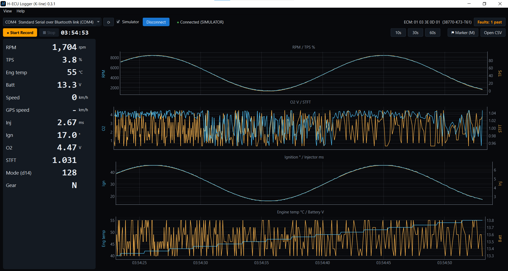
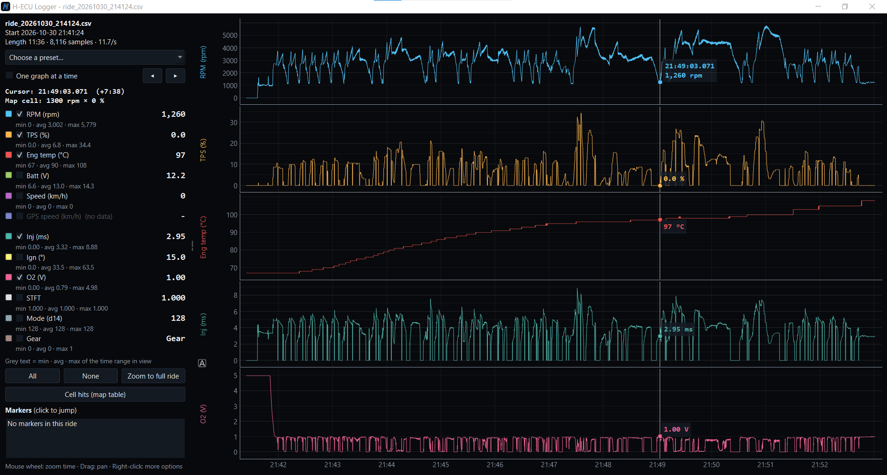
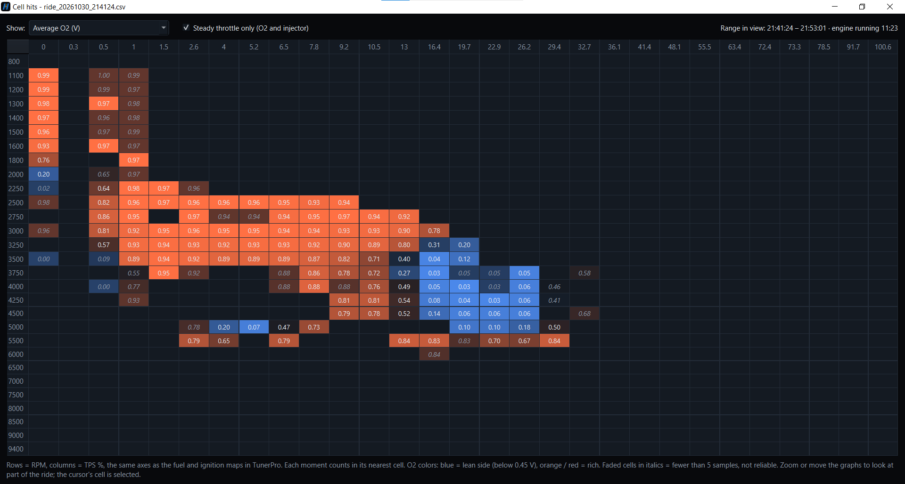

# H-ECU Logger (K-line)

**A live data logger for Honda / Keihin K-line motorcycle ECUs.** Record what the ECU sees while you ride, then study the ride afterwards as graphs and as a map-cell table, to check your road tuning.

You can't look at a screen while riding. So: connect, press **Start Record**, ride, press **Stop**, and look at the log at home.

> **Read-only.** The app only sends the ECU wake-up, init, live-data and fault-code read queries, each checked against a strict whitelist. It has no write, flash or EEPROM commands and never clears fault codes.
> **Never look at the screen while riding.**
> Not affiliated with or endorsed by Honda Motor Co., Ltd.

There are two apps in this repo, and both record the same CSV format:
- **Windows app**: live screen, recording, ride viewer and map-cell table. Described below.
- **Android app** (`android/`): a phone recorder for the handlebar, so you don't need to carry the laptop. Its own section is coming soon.


*Live screen, here in Simulator mode: values on the left, four dual-axis graphs on the right.*

## What you need
- A Windows 10 / 11 PC
- An **FTDI FT232R USB-to-K-line cable** for the bike's 4-pin diagnostic connector (DLC)
- A Honda with a Keihin K-line ECU. Tested on a **Honda Wave 125i (2021)**, ECU 38770-K73-T61. Other K-line Hondas will probably work, but values may need checking (see [Other bikes](#other-bikes)).

## Install
1. Download **`H-ECU-Logger-Setup-<version>.exe`** from [Releases](https://github.com/FACEPOT40/Honda-ECU-Logger/releases).
2. Run it. It installs the app with Start menu shortcuts and an uninstall entry. It also installs FTDI's official cable driver (ticked by default; untick it if your cable already works).
3. Start **H-ECU Logger**. Tick **Simulator** and press **Connect** to try it without a bike.

## On the bike
1. Plug the cable into the DLC and turn the **key ON** (engine off or running), kill switch on RUN.
2. Close any other program that uses the cable (HondaECU, flash tools).
3. Pick the COM port, untick Simulator, press **Connect**. The status shows *Connected*, plus the ECM ID and the ECU part number.
4. Press **Start Record** before you set off and **Stop** when you're back.

Logs are saved as `ride_YYYYMMDD_HHMMSS.csv` in `Documents\HondaECULogger\logs`, or in a `logs` folder next to the app if it was started from a writable folder.

## Features

### Live screen
- **Values:** RPM, TPS, engine temp, battery, speed, injector time, ignition advance, O2 voltage, STFT, Mode (d14) and gear (N / in gear).
- **Four live graphs** (RPM / TPS, O2 / STFT, ignition / injector, engine temp / battery) over a 10 / 30 / 60 s window, with wall-clock time.
- **Start / Stop Record** to CSV with millisecond timestamps.
- **Marker** button or the `M` key marks a moment (e.g. "heard a knock") in the CSV and on the graphs.
- **Red alerts:**
  - Engine temp ≥ 120 °C.
  - Battery < 12.5 V while running.
  - O2 lean (< 0.45 V) at high throttle.
- **Fault codes:** read on connect and with *Read again*. The Faults button turns green (none), orange (past codes) or red (current codes). Codes are only read, never cleared.
- **Auto-reconnect** if the link drops or the cable is unplugged. A running recording carries on when it comes back.
- **Simulator** mode, so you can try everything without a bike.

### Ride viewer
Open a ride with **Open CSV**, by dropping a CSV onto the app, or with `python viewer.py ride.csv`.


*Ride viewer: one graph per value on a shared time axis, with the cursor readout on every graph.*

- **Choose the values:** tick the ones you want and each gets its own graph. Or pick a preset (Overview / Fuel / Ignition / Health / Everything).
- **One graph at a time:** flip through values with ◀ ▶ or Page Up / Page Down.
- **Cursor readout:** move the mouse over any graph to read every value at that moment, next to the cursor and in the side panel. The panel also names the fuel / ignition **map cell** (RPM × TPS) the engine was in.
- **min / avg / max** for the time range in view. Click a marker to jump to it.
- **Navigation:** mouse wheel zooms time and drag pans. Your last selection is remembered.

### Cell hits (map table)
**Cell hits** lays the ride over the same RPM × TPS grid as the fuel and ignition maps in TunerPro. For each cell you can show the time spent there, the average O2, the lean share or the injector time.


*Average O2 per map cell. Blue = lean side (below 0.45 V), orange / red = rich. Faded cells have too few samples to trust.*

- **Steady throttle only** leaves out moments when the throttle is moving, so O2 and injector values reflect steady running.
- It covers the time range in view, so you can zoom the graphs to look at one part of a ride.
- O2 is only counted with the engine fuelling and the sensor warm.

## CSV columns
`timestamp, elapsed_s, rpm, tps_pct, ect_c, batt_v, speed_kmh, inj_ms, ign_deg, o2_v, stft, mode_d14, neutral, gps_kmh, marker, raw_17, raw_20, raw_d1`

- `timestamp` is wall-clock time with milliseconds. `elapsed_s` counts seconds from the start.
- `neutral` is 1 in neutral and 0 in gear. The ECU only knows neutral or in gear, not which gear.
- `gps_kmh` is the phone's GPS speed. It's empty in PC logs.
- `mode_d14` is raw byte 14 of table 0x17. The PGM-FI sheet calls it fast idle, but on the Wave it's always 128, so its meaning is unknown there.
- `raw_*` columns keep the raw table bytes, so values can be recomputed later.

The CSV opens in Excel too.

## Tested hardware
| Item | Value |
|---|---|
| Bike | Honda Wave 125i (2021), ECU 38770-K73-T61, ECM ID 01 03 3E 0D 01 |
| Cable | FTDI FT232R USB-to-K-line, on the 4-pin DLC |
| Driver | Official FTDI VCP driver (shows up as a COM port) |

On the Wave, these were checked against real logs:
- **RPM, TPS, engine temp, battery, ignition:** confirmed. Full throttle reads 93.75 % on the ECU's own scale.
- **Injector time:** HondaECU's scale, checked against ECU-SHOP and the tune's fuel map.
- **STFT:** never moves on the test bike (its tune runs without O2 feedback), so that formula is unverified.
- **Speed:** reads 0 on the Wave, which has a cable speedometer and no ECU speed sensor. It should work on Hondas that have one.

### Other bikes
The live data comes from table 0x17 (main values), 0x20 (O2 / STFT) and 0xD1 (neutral). To check a new bike or ECU, use the console probe. It wakes the ECU, reads the ECM ID and prints the raw table bytes:
```bat
python tools\m0_probe.py --list
python tools\m0_probe.py --port COM3 --seconds 30 -v
python tools\m0_probe.py --port COM3 --dtc -v      # fault codes only
python tools\m0_probe.py --port COM3 --scan        # which tables the ECU answers
```

## Run from source
1. Install **Python 3.12 or newer** from python.org (tick *Add Python to PATH*).
2. In this folder:
   ```bat
   pip install -r requirements.txt
   python app.py
   ```

### Build
```bat
build_exe.bat          rem single file: dist\H-ECU-Logger.exe
build_installer.bat    rem installer:   dist\H-ECU-Logger-Setup-<version>.exe
```
The installer needs:
- [Inno Setup 6](https://jrsoftware.org/isinfo.php) (`winget install JRSoftware.InnoSetup`).
- FTDI's VCP driver package from ftdichip.com, unzipped as `CDM-v2.12.36.20-WHQL-Certified` in this folder. It isn't in git because it's FTDI's.

<details>
<summary>Android build (details coming soon)</summary>

Build with Android Studio, or from the command line with `JAVA_HOME` set to Android Studio's `jbr`:
```bat
android\gradlew.bat testDebugUnitTest assembleDebug
```
A signed release APK comes from `build_apk_release.bat`. It needs your own signing key in `android\keystore.properties`; copy `android\keystore.properties.example` to start. Keep the key and its password backed up and out of git.
</details>

## Credits
- Protocol notes: [AutotronicCommunity/Honda_Keihin_KLine_Protocol](https://github.com/AutotronicCommunity/Honda_Keihin_KLine_Protocol)
- Value formulas and fault-code reads: [HondaECU](https://github.com/aeaphichart/HondaECU-1) (MCU Innovations / RyanHope, GPL-3.0)
- Table layout: RE-ECU-th "Protokol Live Data PGM-FI Honda Bike" sheet

## License
GPL-3.0. Made by FACEPOT40 (ปาย).

Honda is a trademark of its owner. This project is not affiliated with or endorsed by Honda Motor Co., Ltd.
