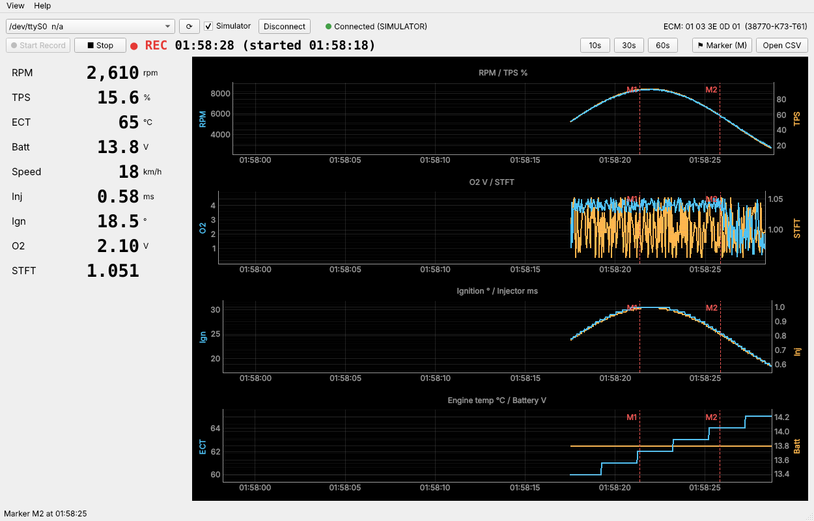

# Honda-ECU-Logger

Record live ECU data from Honda/Keihin K-line motorcycles while you ride, then review the logs as graphs afterwards to check your road-tuning results.

You can't look at a screen while riding. So: connect, press **Start Record**, ride, press **Stop**, and analyze the timestamped CSV later (in the app or in Excel).

> **Read-only.** The app only sends wake-up, init and live-data queries. It contains no ECU write / flash / EEPROM commands.
> **Never look at the screen while riding.**
> Not affiliated with Honda Motor Co.



## Features
- Live values: RPM, TPS, engine temp (ECT), battery, injector time, ignition advance, O2 voltage, STFT, fast idle
  (no speed: the Wave's speedometer is cable-driven, so the ECU never knows the speed)
- Real-time graphs (10 / 30 / 60 s window) with wall-clock time axis
- **Start / Stop Record** to CSV with wall-clock timestamps (ms); `elapsed_s` also saved (hidden on screen by default, *View → Show elapsed time*)
- **Marker** button / `M` key: marks an event (e.g. "heard knock") in the CSV and on the graphs
- Red alerts: engine temp > 110 °C, battery < 12.5 V while running, O2 lean (< 0.45 V) at high throttle
- **Simulator** mode to try the app without a bike
- **Ride viewer** (*Open CSV*): tick the values you want, and each one gets its own graph on a shared time axis
  - Presets: Overview / Fuel / Ignition / Health / Everything
  - **One graph at a time** with ◀ ▶ (or Page Up / Page Down) to flip through values
  - Move the mouse over any graph to read **every value at that moment**, shown on each graph next to the cursor and in the side panel
  - min / avg / max for the time range in view; click a marker to jump to it
  - Mouse wheel zooms time; your last selection is remembered
  - Drop a CSV onto the .exe, or run `python viewer.py ride.csv`, to open it directly
- Auto-reconnect if the K-line link drops

## Tested hardware
| Item | Value |
|---|---|
| Bike | Honda Wave 125i (2021), ECU 38770-K73-T61 (ECM ID 01 03 3E 0D 01) |
| Cable | FTDI FT232R USB-to-K-line, on the red 4-pin DLC |
| Driver | Official FTDI VCP driver (shows as a COM port) |

The table 0x17 layout follows the RE-ECU-th PGM-FI live data sheet and was checked against real Wave logs: RPM, TPS (full throttle reads 93.75 %, the ECU's own scale), engine temp, battery and ignition are confirmed. ⚠️ Injector scale and STFT are **not yet verified** on a warm engine. Raw bytes are always saved (`raw_17`, `raw_20`) so values can be recomputed later.

## Install & run (Windows)
1. Install **Python 3.12** from python.org (tick *Add Python to PATH*).
2. In this folder:
   ```bat
   pip install -r requirements.txt
   python app.py
   ```
3. Tick **Simulator** and press **Connect** to try it without a bike.

### On the bike
1. Cable in the DLC, **key ON** (engine off or running), kill switch on RUN.
2. Close other programs using the cable (HondaECU, Honda Flash EcuK-Line Tools).
3. Choose the COM port, untick Simulator, **Connect**.
4. **Start Record** before setting off, **Stop** when back. Logs are saved in `logs\ride_YYYYMMDD_HHMMSS.csv`.

### Build a single .exe
```bat
build_exe.bat
```
Output: `dist\HondaECULogger.exe`

## CSV columns
`timestamp, elapsed_s, rpm, tps_pct, ect_c, batt_v, inj_ms, ign_deg, o2_v, stft, fast_idle, marker, raw_17, raw_20`

## Protocol test tool
`tools/m0_probe.py` is a console script that wakes the ECU, reads the ECM ID and prints raw table bytes. Use it to verify a new bike/ECU:
```bat
python tools\m0_probe.py --list
python tools\m0_probe.py --port COM3 --seconds 30 -v
```

## Credits
- Protocol notes: [AutotronicCommunity/Honda_Keihin_KLine_Protocol](https://github.com/AutotronicCommunity/Honda_Keihin_KLine_Protocol)
- Value formulas: [HondaECU](https://github.com/aeaphichart/HondaECU-1) (MCU Innovations / RyanHope, GPL-3.0)
- Table layout: RE-ECU-th "Protokol Live Data PGM-FI Honda Bike" sheet

## License
GPL-3.0
